

<picture><source media="(prefers-color-scheme: dark)" srcset="assets/hero-dark.svg"></picture>

**Daniel Soleimani** · Machine Learning Developer · Tehran, open to remote work
 
[danielsoleimany@gmail.com](mailto:danielsoleimany@gmail.com) · [Kaggle](https://www.kaggle.com/danielsolo1770)

<picture><source media="(prefers-color-scheme: dark)" srcset="assets/h-work-dark.svg"></picture>

<a href="https://github.com/danielsolo707/RSNA-Knee-MRI-Detection"><picture><source media="(prefers-color-scheme: dark)" srcset="assets/rsna-dark.svg"></picture></a> <a href="https://github.com/danielsolo707/BirdCLEF"><picture><source media="(prefers-color-scheme: dark)" srcset="assets/bird-dark.svg"></picture></a>

<a href="https://github.com/danielsolo707/AlphaMath"><picture><source media="(prefers-color-scheme: dark)" srcset="assets/alpha-dark.svg"></picture></a> <a href="https://github.com/danielsolo707/BipedalWalker-PPO"><picture><source media="(prefers-color-scheme: dark)" srcset="assets/walker-dark.svg"></picture></a>

<a href="https://github.com/danielsolo707/AI-Agent-Security"><picture><source media="(prefers-color-scheme: dark)" srcset="assets/sec-dark.svg"></picture></a> <a href="https://github.com/danielsolo707/gesture-canvas-museum"><picture><source media="(prefers-color-scheme: dark)" srcset="assets/hand-dark.svg"></picture></a>

<a href="https://github.com/danielsolo707/RSNA-Knee-MRI-Detection">RSNA Knee MRI</a> ·
<a href="https://github.com/danielsolo707/BirdCLEF">BirdCLEF</a> ·
<a href="https://github.com/danielsolo707/AlphaMath">AlphaMath</a> ·
<a href="https://github.com/danielsolo707/BipedalWalker-PPO">BipedalWalker-PPO</a> ·
<a href="https://github.com/danielsolo707/AI-Agent-Security">AI-Agent-Security</a> ·
<a href="https://github.com/danielsolo707/gesture-canvas-museum">gesture-canvas-museum</a> (<a href="https://danielsolo707.github.io/gesture-canvas-museum/">live demo</a>)

<picture><source media="(prefers-color-scheme: dark)" srcset="assets/h-notes-dark.svg"></picture>

<picture><source media="(prefers-color-scheme: dark)" srcset="assets/method-dark.svg"></picture>

<picture><source media="(prefers-color-scheme: dark)" srcset="assets/notes-dark.svg"></picture>

<picture><source media="(prefers-color-scheme: dark)" srcset="assets/h-tools-dark.svg"></picture>

<picture><source media="(prefers-color-scheme: dark)" srcset="assets/toolkit-dark.svg"></picture>

<picture><source media="(prefers-color-scheme: dark)" srcset="assets/h-hello-dark.svg"></picture>

<picture><source media="(prefers-color-scheme: dark)" srcset="assets/contact-dark.svg"></picture>

[**Email me**](mailto:danielsoleimany@gmail.com) · [**Kaggle**](https://www.kaggle.com/danielsolo1770) · [**All repositories**](https://github.com/danielsolo707?tab=repositories)

Every number on this page comes from my repositories’ own result files and READMEs — including the ones that didn’t go my way.

